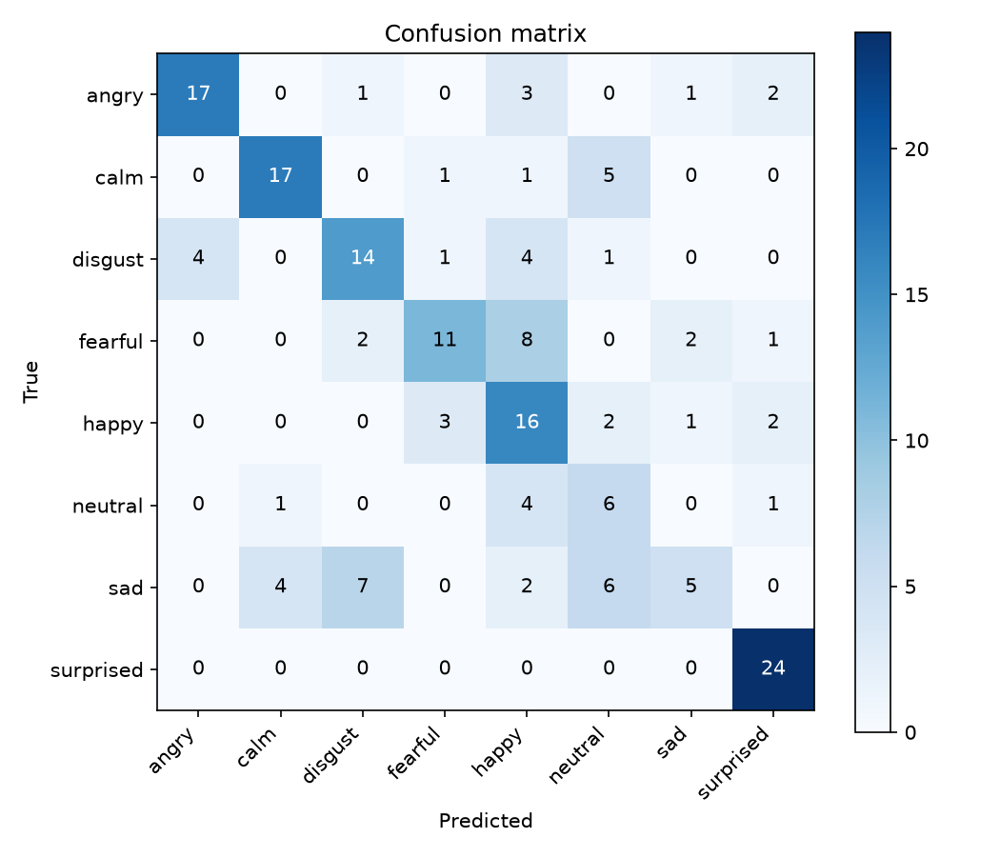

# Speech Emotion Recognition Using Deep Learning

## 1. Project Overview

This project focuses on recognizing human emotions from speech audio using Deep Learning. It uses the **RAVDESS (Ryerson Audio-Visual Database of Emotional Speech and Song)** dataset to classify speech into eight different emotional categories.

The project implements a **Convolutional Neural Network (CNN) combined with a Bidirectional Long Short-Term Memory (Bi-LSTM)** network.

The CNN extracts important patterns from audio features, while the Bi-LSTM learns sequential information from the speech signal.

This project was developed as part of the **CodeAlpha Machine Learning Internship**.

## 2. Objectives

The main objectives of this project are:

- Understand how audio data can be processed for Machine Learning.
- Extract meaningful features from speech using MFCC.
- Build a deep learning model for speech emotion classification.
- Train and evaluate a CNN + Bi-LSTM model.
- Test the model using audio recordings from speakers that were not included in training.
- Analyze the model's performance and limitations.

## 3. Dataset

This project uses the **RAVDESS Speech Emotion Dataset**.

The speech dataset contains recordings from 24 professional actors. The original dataset contains 1,440 speech audio files.

The model recognizes eight emotional categories:

| Label | Emotion |
|---|---|
| 1 | Neutral |
| 2 | Calm |
| 3 | Happy |
| 4 | Sad |
| 5 | Angry |
| 6 | Fearful |
| 7 | Disgust |
| 8 | Surprised |

The dataset is organized into actor folders, with each folder containing audio recordings from an individual actor.

### Dataset Split

To evaluate how well the model performs on speakers it has never seen during training, the dataset is divided by actor:

- **Training:** Actors 01–18
- **Validation:** Actors 19–21
- **Testing:** Actors 22–24

This speaker-independent split helps evaluate the model's ability to generalize to different speakers.

## 4. Technologies and Libraries

The project was developed using Python and the following libraries:

| Technology | Purpose |
|---|---|
| Python | Main programming language |
| TensorFlow | Deep Learning framework |
| Keras | Building and training the neural network |
| Librosa | Audio processing and feature extraction |
| NumPy | Numerical operations |
| Pandas | Data handling |
| Scikit-learn | Data splitting and model evaluation |
| Matplotlib | Visualization of training results |
| SoundFile | Reading audio files |

## 5. Project Structure

```text
CodeAlpha_SpeechEmotionRecognition/
│
├── data_speach/
│   ├── Actor_01/
│   ├── Actor_02/
│   ├── ...
│   └── Actor_24/
│
├── outputs/
│   ├── emotion_model.keras
│   ├── norm_stats.npz
│   ├── training_curves.png
│   └── confusion_matrix.png
│
├── emotion_recognition.py
├── predict.py
├── requirements.txt
├── .gitignore
└── README.md
```

Note: `data_speach` is the dataset folder name used in my local project. The dataset itself is not included in this GitHub repository.

## 6. Audio Preprocessing and Feature Extraction

Before training the model, the audio recordings are processed to make them suitable for deep learning.

The preprocessing steps include:

1. **Audio Loading:** Load audio recordings using Librosa.
2. **Resampling:** Convert audio to a sampling rate of 22,050 Hz.
3. **Silence Removal:** Trim unnecessary silence from recordings.
4. **Duration Adjustment:** Pad or cut audio to a fixed duration of 3 seconds.
5. **MFCC Extraction:** Extract 40 Mel-Frequency Cepstral Coefficients (MFCCs).
6. **Delta Features:** Calculate delta features to capture changes in audio characteristics over time.
7. **Data Augmentation:** Apply noise addition, pitch shifting, and time stretching to increase training data.
8. **Normalization:** Normalize the extracted features using statistics calculated from the training data.

The resulting feature representation has the shape:

```text
(130, 80)
```

This represents 130 time frames and 80 features per frame, combining MFCC and delta information.

### Data Augmentation

To increase the diversity of training data, three augmented versions are generated for each original training recording.

The augmentation techniques include:

- Adding background noise.
- Pitch shifting.
- Time stretching.

After augmentation, the dataset contains:

| Dataset | Number of Samples |
|---|---:|
| Training | 4,320 |
| Validation | 180 |
| Testing | 180 |
| **Total** | **4,680** |

The 1,440 original audio files produce 4,320 augmented training samples, while validation and test data remain separate.

## 7. Model Architecture

The project uses a hybrid CNN + Bi-LSTM architecture.

### CNN Layers

The CNN component extracts important patterns from the audio features.

It consists of:

- First Conv1D layer with 64 filters.
- Batch Normalization.
- Max Pooling.
- Second Conv1D layer with 128 filters.
- Batch Normalization.
- Max Pooling.
- Dropout.

### Bidirectional LSTM

The Bi-LSTM layer processes the extracted features in both forward and backward directions.

This allows the model to learn information from different points in the audio sequence.

### Dense and Output Layers

The final layers include:

- Dense layer with 128 neurons.
- Dropout for regularization.
- Softmax output layer with 8 neurons.

Each output neuron represents one emotion category.

### Model Summary

| Component | Configuration |
|---|---|
| Input shape | (130, 80) |
| First Conv1D | 64 filters |
| Second Conv1D | 128 filters |
| Recurrent layer | Bidirectional LSTM |
| Dense layer | 128 neurons |
| Output layer | 8 classes |
| Total parameters | 364,616 |
| Trainable parameters | 364,232 |

## 8. Model Training

The model was trained using the following configuration:

| Parameter | Value |
|---|---|
| Optimizer | Adam |
| Initial learning rate | 0.001 |
| Loss function | Sparse Categorical Crossentropy |
| Maximum epochs | 60 |
| Early Stopping patience | 12 |
| Learning rate adjustment | ReduceLROnPlateau |
| Batch size | 32 |

Early Stopping was used to stop training when validation performance stopped improving.

The training process stopped at **epoch 26 out of 60**.

## 9. Model Evaluation Results

The trained model was evaluated using 180 test samples from speakers that were not included in the training or validation sets.

### Overall Performance

| Metric | Result |
|---|---:|
| Test Accuracy | **61.1%** |
| Macro Precision | 61.6% |
| Macro Recall | 60.4% |
| Macro F1-score | **58.9%** |
| Weighted F1-score | 60.3% |

### Classification Report

| Emotion | Precision | Recall | F1-score |
|---|---:|---:|---:|
| Angry | 0.810 | 0.708 | 0.756 |
| Calm | 0.773 | 0.708 | 0.739 |
| Disgust | 0.583 | 0.583 | 0.583 |
| Fearful | 0.688 | 0.458 | 0.550 |
| Happy | 0.421 | 0.667 | 0.516 |
| Neutral | 0.300 | 0.500 | 0.375 |
| Sad | 0.556 | 0.208 | 0.303 |
| Surprised | 0.800 | 1.000 | 0.889 |

### Training Curves

The following figure shows the model's training and validation accuracy and loss over the training epochs.


### Confusion Matrix

The confusion matrix shows how the model classified each emotion and where misclassifications occurred.



## 10. Discussion and Limitations

The model achieved 61.1% test accuracy and a 58.9% macro F1-score.

The best-performing emotion was **Surprised**, with an F1-score of 88.9%. Angry and Calm also achieved relatively good results.

However, the model had difficulty recognizing Sad and Neutral emotions, with F1-scores of 30.3% and 37.5%, respectively.

One important observation is the difference between training and validation performance.

The training accuracy reached approximately 99.9%, while validation accuracy remained around 58–62%.

This indicates **overfitting**. The model learned the training data very well but did not generalize equally well to unseen speakers.

Possible improvements include:

- Increasing regularization and dropout.
- Reducing model complexity.
- Using additional speech emotion datasets.
- Experimenting with different audio features.
- Testing other deep learning architectures.

## 11. Prediction Example

The project includes a prediction script that can classify emotions from individual audio files.

Example command:

```bash
python predict.py "data_speach/Actor_23/03-01-08-01-01-01-23.wav"
```

Example predictions from Actor 23:

| Audio File | Actual Emotion | Predicted Emotion |
|---|---|---|
| 03-01-08-01-01-01-23.wav | Surprised | Surprised |
| 03-01-05-02-02-02-23.wav | Angry | Angry |
| 03-01-07-01-01-01-23.wav | Disgust | Disgust |
| 03-01-06-01-01-01-23.wav | Fearful | Disgust |

These examples demonstrate how the trained model makes predictions on individual recordings. They are demonstration samples, not a replacement for the overall test evaluation.

## 12. Installation and Usage

### Step 1: Clone the Repository

```bash
git clone https://github.com/Tavonga03/CodeAlpha_SpeechEmotionRecognition.git
```

### Step 2: Enter the Project Directory

```bash
cd CodeAlpha_SpeechEmotionRecognition
```

### Step 3: Create a Virtual Environment

```bash
python -m venv .venv
```

Activate it on Windows PowerShell:

```powershell
.\.venv\Scripts\Activate.ps1
```

### Step 4: Install Dependencies

```bash
python -m pip install -r requirements.txt
```

### Step 5: Prepare the Dataset

Download the RAVDESS speech dataset and organize it into actor folders:

```text
data_speach/
├── Actor_01/
├── Actor_02/
├── ...
└── Actor_24/
```

### Step 6: Train the Model

Run the following command:

```bash
python emotion_recognition.py --data_dir "data_speach" --epochs 60
```

The script extracts audio features, applies data augmentation, trains the CNN + Bi-LSTM model, evaluates the model, and saves the output files inside the `outputs/` directory.

### Step 7: Predict an Emotion

Use the prediction script with an audio file:

```bash
python predict.py "data_speach/Actor_23/03-01-08-01-01-01-23.wav"
```

## 13. Output Files

After training, the following files are generated:

| File | Description |
|---|---|
| `emotion_model.keras` | Trained CNN + Bi-LSTM model |
| `norm_stats.npz` | Feature normalization statistics |
| `training_curves.png` | Training and validation curves |
| `confusion_matrix.png` | Confusion matrix visualization |

## 14. Future Improvements

There are several ways this project could be improved in the future:

- Improve generalization to unseen speakers.
- Experiment with stronger regularization techniques.
- Combine MFCC with Mel Spectrogram or Chroma features.
- Increase the amount of training data using additional datasets such as TESS or EMO-DB.
- Explore advanced architectures such as CNN-BiLSTM with attention or pretrained speech models.

## 15. Conclusion

This project demonstrates how Deep Learning can be applied to speech emotion recognition using audio feature extraction and neural networks.

By combining CNN and Bi-LSTM layers, the model can learn both acoustic patterns and sequential information from speech recordings.

The final model achieved **61.1% test accuracy** and a **58.9% macro F1-score** on unseen speakers.

Although the model shows promising results for some emotion categories, overfitting and differences in recognition performance between emotions remain important limitations.

This project helped me understand audio preprocessing, MFCC feature extraction, data augmentation, neural network architecture, model training, and evaluation in a practical Machine Learning application.

---

## Author

**Tavonga**

Machine Learning Internship Project – CodeAlpha

GitHub Repository: https://github.com/Tavonga03/CodeAlpha_SpeechEmotionRecognition