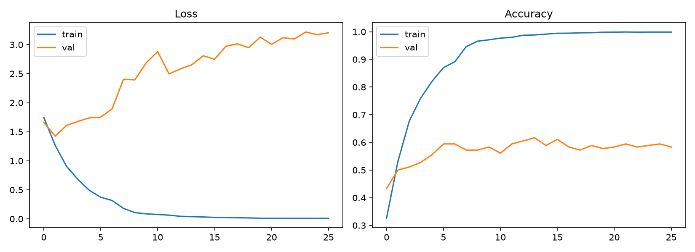

# CodeAlpha_SpeechEmotionRecognition

My submission for **Task 2: Emotion Recognition from Speech** in the CodeAlpha Machine Learning Internship.

In this project I built a deep learning model that recognises 8 human emotions from speech audio. It extracts MFCC features from each recording and classifies them with a CNN + Bi-LSTM network.

---

## What I did, step by step

### Step 1: Read the task
The task asked me to recognise emotions such as happy, angry and sad from speech, using speech signal processing and deep learning. It suggested MFCC features, a CNN, RNN or LSTM model, and datasets such as RAVDESS, TESS or EMO-DB. I chose **RAVDESS** and a model that combines a CNN with an LSTM.

### Step 2: Set up my environment
- I created the project folder `CodeAlpha_SpeechEmotionRecognition`, as the internship instructions require.
- I installed the libraries with `pip install -r requirements.txt` (librosa, TensorFlow, Keras, scikit-learn, NumPy, Matplotlib, soundfile).
- My setup: Windows, Python 3.14, TensorFlow 2.22 (release candidate), librosa 1.0.1.

### Step 3: Get the dataset (and fix two mistakes)
RAVDESS is split into separate downloads for speech, song and video. Every file name encodes its labels, for example `03-01-06-01-02-01-12.wav`: the second number is the vocal channel (`01` speech, `02` song), the third number is the emotion, and the last number is the actor ID.

- **Mistake 1, placeholder path:** my first run failed with `No .wav files found under path/to/RAVDESS`, because I had copied the example placeholder path instead of my real folder.
- **Mistake 2, wrong download:** I first trained on `Audio_Song_Actors_01-24.zip` by accident. I noticed because my file names started with `03-02-` (song), the dataset had only 1,012 clips, and the model had only 6 emotion classes. The task is about speech, so I discarded that run, downloaded `Audio_Speech_Actors_01-24.zip`, and confirmed it had **1,440 files** with names starting `03-01-` before retraining.

The final dataset is RAVDESS speech: 24 actors, 1,440 clips, 8 emotions (angry, calm, disgust, fearful, happy, neutral, sad, surprised).

### Step 4: Pre-process the audio
In `emotion_recognition.py` I:
1. Load each clip at 22,050 Hz and trim leading and trailing silence.
2. Pad or cut every clip to exactly 3 seconds, so all inputs have the same size.
3. Extract **40 MFCCs plus their delta (change over time) values** for every frame, which gives an input of shape 130 frames x 80 features.
4. Create **3 augmented copies** of each training clip (added noise, pitch shift, time stretch), so the model sees more variety.

### Step 5: Split the data by speaker
I split the data by **actor**, not randomly: actors 1-18 for training, 19-21 for validation and 22-24 for testing. This means the model is tested on voices it has never heard, so the accuracy isn't inflated by the same speaker appearing in both train and test. The final sets were 4,320 training samples (with augmentation), 180 validation clips and 180 test clips. Features are normalised using statistics from the training set only.

### Step 6: Build the model
- Two Conv1D blocks (64 and 128 filters) with Batch Normalization and Max Pooling to pick up short-term sound patterns.
- A Bi-LSTM layer (128 units each direction) to learn how the patterns change over time.
- A Dense layer with Dropout, and a Softmax output with 8 units, one per emotion.
- 364,616 parameters in total.

### Step 7: Train
- Optimizer: Adam (learning rate 0.001), loss: sparse categorical cross-entropy.
- Early Stopping (patience 12) keeps the best weights, and Reduce LR on Plateau lowers the learning rate when progress stalls.
- Training stopped at **epoch 26 of a maximum 60**, and each epoch took about 4 seconds on my CPU.

```bash
python emotion_recognition.py --data_dir "path\to\data_speech" --epochs 60
```

### Step 8: Evaluate
The script prints a classification report on the unseen test speakers and saves the model, `training_curves.png` and `confusion_matrix.png` to the `outputs/` folder.

---

## My results

**Test accuracy: 61.1%** (macro-F1 0.589) on 180 clips from 3 speakers the model never heard. Random guessing across 8 classes would give about 12.5%.

| Emotion | Precision | Recall | F1-score | Test clips |
|---------|-----------|--------|----------|-----------|
| angry     | 0.810 | 0.708 | 0.756 | 24 |
| calm      | 0.773 | 0.708 | 0.739 | 24 |
| disgust   | 0.583 | 0.583 | 0.583 | 24 |
| fearful   | 0.688 | 0.458 | 0.550 | 24 |
| happy     | 0.421 | 0.667 | 0.516 | 24 |
| neutral   | 0.300 | 0.500 | 0.375 | 12 |
| sad       | 0.556 | 0.208 | 0.303 | 24 |
| surprised | 0.800 | 1.000 | 0.889 | 24 |

**What I noticed**
- **Surprised, angry and calm are easiest** (F1 0.74-0.89). Surprised was found in every test clip.
- **Sad is the hardest:** only about 21% of sad clips were recognised. Happy and neutral have low precision, which suggests other emotions were often labelled as happy or neutral. _I should check this in `confusion_matrix.png`._
- **Strong overfitting:** training accuracy reached about 99.9% while validation accuracy stayed around 58-62%, and validation loss started rising after epoch 2. Early Stopping restored the best weights (from epoch 14), but the gap shows the model is memorising the training speakers.
- **Small test set:** only 180 clips from 3 actors, and 12 neutral clips, so a few clips can shift the scores.
- **Hard problem:** recognising emotion from unseen speakers is much harder than from speakers seen in training, and acted emotions in 8 classes overlap a lot.




---

## How to run my project

```bash
git clone https://github.com/Tavonga03/CodeAlpha_SpeechEmotionRecognition.git
cd CodeAlpha_SpeechEmotionRecognition
pip install -r requirements.txt
python emotion_recognition.py --data_dir "path/to/data_speech" --epochs 60
python predict.py "path/to/some_clip.wav"
```

The RAVDESS audio is not included in this repo because of its size. Download `Audio_Speech_Actors_01-24.zip` from Zenodo (the **speech** file, not song) and point `--data_dir` at the extracted folder. `predict.py` needs the model that training saves in `outputs/`, so train first.

## Project files

| File | Purpose |
|------|---------|
| `emotion_recognition.py` | Loads audio, extracts MFCCs, trains and evaluates the model |
| `predict.py` | Predicts the emotion of one audio file |
| `requirements.txt` | Python libraries needed |
| `outputs/` | Saved model, plots and normalisation statistics (created after training) |

## What I learned
- What MFCC features are and why they are used to represent speech for machine learning.
- How a CNN finds short sound patterns and an LSTM learns how they change over time.
- Why splitting by speaker gives a more honest accuracy than a random split, and why the score is lower.
- How to read a classification report and spot overfitting from the training curves.
- How to check my data: reading file names caught that I had downloaded the song set instead of speech.

## Ideas to improve it
- Reduce overfitting with stronger dropout, a smaller model, and SpecAugment-style masking of the features.
- Add more voices from TESS or EMO-DB, or fine-tune a pretrained speech model such as wav2vec 2.0.
- Add mel-spectrogram or chroma features alongside the MFCCs.